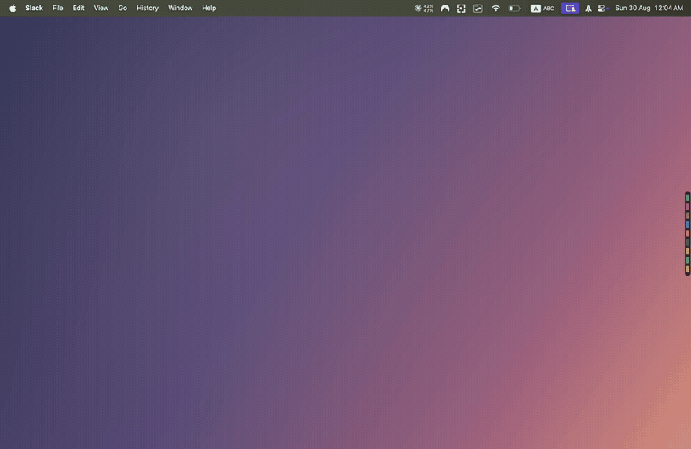
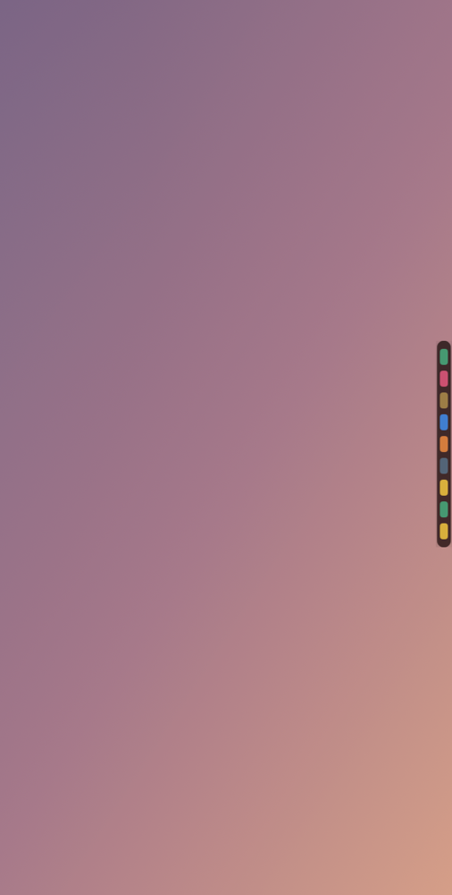
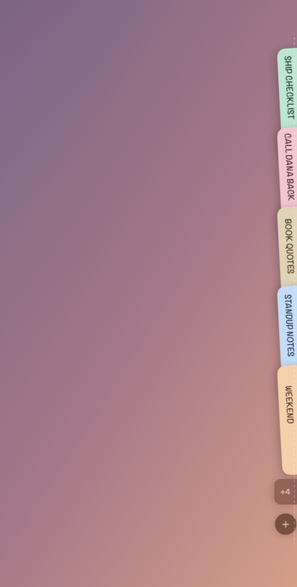
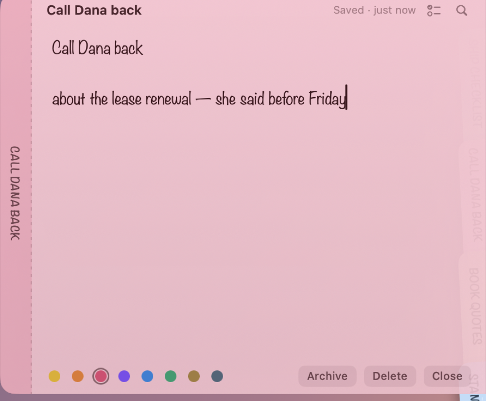

# NoneNote

Sticky notes that live at the edge of your screen. A native macOS app in Swift,
SwiftUI and AppKit.

No dock icon, no window to manage. Slide the pointer to the right edge and the
deck fans out.

**[Download the latest DMG](https://github.com/91zgaoge/NoneNote-macOS/releases/latest/download/NoneNote.dmg)**

A rebranded fork of [noty](https://github.com/aimen08/noty) by Aymen Hamza (MIT) —
see [Credits](#credits).



| At rest | Fanned | A note pulled open |
|---|---|---|
|  |  |  |

## Three states, one movement

| State | What you see | Trigger |
|---|---|---|
| **Rest** | A 12 pt pill on the screen edge — one coloured dash per note | idle |
| **Fan** | Notes shingle down the edge 45 ms apart as vertical tabs, each keeping its colour and carrying its label turned on its side | pointer enters the pill |
| **Expanded** | The note slides clear of the deck at full size, level with its own tab, which stays visible behind it | click a tab |

The deck shows **five notes at a time** and puts the rest behind a `+N` tab, which
opens the full list in a scrolling deck. A `+` button sits in the bottom corner
while the deck is open.

Tabs **shingle**: each one is full height but sits only a strip below the one
before, lapping over it like a roof tile. That is what keeps the deck to roughly
half the screen height instead of running its full length. The strip is sized to
the longest title currently on the deck, so labels read in full and ellipsise
cleanly rather than being clipped mid-word.

The fan is only 56 pt wide, so the deck covers almost none of what is behind it.

### Two deck styles

Right-click the pill → **Deck style**:

| | |
|---|---|
| **Labelled tabs** | Full-size tabs carrying their titles — the default |
| **Colour chips** | Colour only, no labels; the deck shrinks to a row of chips |

The open note carries its own tab along as a left gutter, separated by a dashed
rule, so it reads as growing out of the deck rather than floating beside it.

## Shortcuts

All of these are listed in Settings (`⌘,`), and the first four can be rebound
there. Global ones are registered through the Carbon hotkey API, so **no
Accessibility permission is required**:

| | |
|---|---|
| `⌥⌘N` | new note (opens it straight away) |
| `⌥⌘A` | All Notes |
| `⌥⌘L` | the Archive window |

Inside a note:

| | |
|---|---|
| `Esc` | close the note, back to the tabs (or dismiss the find bar) |
| `⌘F` | find in note |
| `⌘.` | cycle its colour |
| `⌘T` | turn the current line into a task, or strip the checkbox off |
| `⌘⌫` | delete, with ten seconds to undo |
| `⇧⌘A` | archive the note you are looking at |
| `⌘P` | pin the note so it stays open |
| `⌃+` / `⌃-` | bigger / smaller note text |

Standard editing (`⌘C` / `⌘V` / `⌘Z` / `⌘A`) works everywhere — the app builds a
main menu at launch purely so those key equivalents dispatch, even though an
accessory app draws no menu bar.

## Checkbox tasks

Any line can be a task. `⌘T` (or the checklist button in a note's header) puts a
checkbox on the current line; **click the box to tick it off** and the line is
struck through and dimmed. Return carries the list on to the next task, and
Return on an empty task ends the list.

Tasks live inline in the note body as `☐` / `☑` prefixes, so a note stays plain
text. Markdown export writes them as standard `- [ ]` / `- [x]` task syntax and
import reads that back. All Notes shows a `done/total` count per note.

## Everything else

- **Archived, not deleted.** Archiving pulls a note out of the deck but keeps it
  in All Notes → Archive, restorable at any time.
- **All Notes** (`⌥⌘A`) — one window, search across every note body and title,
  with an editable detail pane.
- **Multi-display** — each screen gets its own dormant pill on its right edge.
  The deck opens on whichever screen the pointer enters and the others stay shut.
  Displays are tracked by `CGDirectDisplayID`, so hot-plugging rebuilds the decks.
- **Over full-screen apps** — right-click the pill → *Show over full-screen apps*.
  This raises the panel to `.statusBar` level; `.floating` alone does not draw
  over a full-screen space.
- **Autosave** 250 ms after you stop typing, and again on close.
- **Settings** (`⌘,`, or right-click the pill). Rebind the shortcuts, pick the
  note face and size, set how far from the edge the pointer wakes the deck,
  and switch Markdown styling on or off. Everything applies immediately.
- **Markdown as you type.** `# headings`, `**bold**`, `*italic*`, `` `code` ``,
  `~~struck~~`, `> quotes` and `- bullets` are styled in place. The markers are
  dimmed rather than hidden, so the stored text is exactly what you typed and
  exports unchanged.
- **Drag to reorder.** Press and hold a tab, then drag it up or down the deck.
- **Pin a note to keep it open.** The pin in a note's header (or `⌘P`) stops it
  being dismissed by anything you did not aim at it — clicking away in another
  app, or leaving it idle. Esc and Close still close it. Pinned tabs carry a dot,
  and the pin is remembered.
- **Closing a note steps back to the deck.** Esc, Close, archiving or deleting
  leaves the tabs where they were; only moving away from the edge puts the deck
  back to sleep. Clicking in another app dismisses the whole thing.
- **Tidies itself away.** A fan left untouched collapses after 4 seconds; an open
  note after a minute idle.
- **Export** — Markdown (one `.md` per note), plain text (one `.txt` per note),
  a single document, or a `.stickies` archive that preserves colours, archived
  state and dates. **Import** reads `.stickies` back, and will also take loose
  `.md` / `.txt` files.
- Right-click the pill for the full menu: new note, windows, edge side, launch at
  login, export, import, quit.

## Your notes stay on your Mac

- Local SQLite database in `~/Library/Application Support/NoneNote/`.
- **Note bodies are encrypted with AES-GCM** (CryptoKit, 256-bit). Titles,
  colours and timestamps stay in plaintext so lists render without unsealing
  every row.
- No account, no server, no analytics, no telemetry, no tracking SDKs.
- **One network request, ever:** Sparkle fetches the appcast to see whether a
  newer version exists. Nothing about your notes is sent — it is a plain GET of
  a public XML file. Turn it off with *Check automatically* in the pill's menu,
  and it never fires again.
- No Accessibility permission, no Screen Recording, no system permissions.

Verify it yourself:

```sh
sqlite3 ~/Library/Application\ Support/NoneNote/notes.db "SELECT hex(substr(body,1,24)) FROM notes;"
strings ~/Library/Application\ Support/NoneNote/notes.db | grep "some text from a note body"   # finds nothing
```

## Build

Requires the Swift toolchain from Command Line Tools (**Xcode is not needed**)
and macOS 15+.

```sh
./scripts/fetch-sparkle.sh   # once — pulls the Sparkle binary framework
./build.sh                   # release build → build/NoneNote-<version>.app
./build.sh debug             # fast, unoptimised
./build.sh release run       # build, then relaunch
open build/NoneNote-1.3.1.app
```

`build.sh` drives `swiftc` directly over `Sources/*.swift`, assembles the
`.app` bundle around `Info.plist`, embeds Sparkle, and signs it. It also leaves a
`build/Noty.app` symlink pointing at the real bundle for older notes and scripts —
prefer the `NoneNote-<version>.app` name, and never hand a symlink to
`actions/upload-artifact`, which does not follow them.

Sparkle is optional. Without `Sparkle/Sparkle.framework` the app still builds —
`Updater.swift` compiles to a stub and the update menu says so.

### Releasing

```sh
git tag v1.0.1 && git push origin v1.0.1
```

That fires `.github/workflows/release.yml`, which builds and signs the app,
packages a DMG, notarizes and staples both, signs the update with the EdDSA key,
writes `appcast.xml`, publishes a GitHub Release and commits the appcast so
installed copies can see the update.

It needs seven repository secrets.

| Secret | What it is |
| --- | --- |
| `APPLE_CERTIFICATE` | base64 of the Developer ID Application `.p12` |
| `APPLE_CERTIFICATE_PASSWORD` | the password set when exporting that `.p12` |
| `APPLE_SIGNING_IDENTITY` | `Developer ID Application: Name (TEAMID)` |
| `APPLE_ID` | Apple ID enrolled in the Developer Program |
| `APPLE_PASSWORD` | an app-specific password for that Apple ID |
| `APPLE_TEAM_ID` | the 10-character team ID |
| `SPARKLE_PRIVATE_KEY` | the EdDSA key `Sparkle/bin/generate_keys -x` exported |

The first six are the same names StoryMoss passes to `tauri-action`, so the two
projects can share them. The release job checks them before it builds and fails
loudly if any are missing — publishing an unnotarized DMG is the one outcome
worth refusing to ship, because Gatekeeper blocks it on every machine that
downloads it.

The EdDSA key pair is NoneNote's own, not upstream noty's: an update signed by
any key other than the one whose public half is in `Info.plist` as
`SUPublicEDKey` is refused by the installed app, silently. Generate it once, and
keep a backup — losing it means no installed copy will ever accept an update
again.

```sh
./Sparkle/bin/generate_keys                          # prints the public key
./Sparkle/bin/generate_keys -x sparkle_keys/private_key.txt   # the secret's value
```

Paste the public key into `Info.plist` and the file's contents into
`SPARKLE_PRIVATE_KEY`. `sparkle_keys/` is gitignored; `./scripts/make-appcast.sh`
signs each release with it, and `scripts/release-macos.sh` will not get past the
appcast step without it.

To produce `APPLE_CERTIFICATE`, export the Developer ID Application certificate
and its private key from Keychain Access as a `.p12` (Keychain Access writes the
format `security import` can read), then base64 it:

```sh
base64 -i DeveloperID.p12 | pbcopy   # paste into the APPLE_CERTIFICATE secret
```

`APPLE_PASSWORD` is an app-specific password generated at
[appleid.apple.com](https://appleid.apple.com), not the Apple ID's own password.
A `.p12` re-written with `openssl pkcs12 -export` needs `-legacy`, because
OpenSSL 3 defaults to a format `security import` rejects.

#### Signing and notarization

A build signed with `-` (the default) is ad-hoc. That is fine on the machine that
built it and nowhere else: ad-hoc signed apps carry no Team ID, so Gatekeeper
rejects any copy that arrives with a quarantine attribute, which is every copy
that was downloaded, AirDropped or fetched from CI. `spctl` reports it as
`Code did not match any currently allowed policy` and the process never starts.

To sign and notarize by hand:

```sh
APPLE_ID=you@example.com APPLE_PASSWORD=abcd-efgh-ijkl-mnop APPLE_TEAM_ID=TEAMID1234 \
CODESIGN_IDENTITY="Developer ID Application: Name (TEAMID)" \
./scripts/release-macos.sh 1.0.1
```

`release-macos.sh` imports a certificate when `APPLE_CERTIFICATE` is set (that is
what CI does) and otherwise uses the Developer ID already in the login keychain.
It builds, packages the DMG, then notarizes and staples the app and the DMG. If
you only want a DMG and not the notarization round trip:

```sh
./build.sh release && ./scripts/make-dmg.sh 1.0.1
```

`scripts/notarize.sh <path>...` notarizes and staples any signed `.app` or `.dmg`
on its own; without credentials it prints a notice and skips, unless
`NOTARIZE=required` is set. A stored profile works too:
`xcrun notarytool store-credentials notary --apple-id ... --team-id ...` then
`NOTARY_PROFILE=notary ./scripts/notarize.sh build/NoneNote-1.3.1.dmg`.

**Why Sparkle is re-signed.** Sparkle's release tarball is ad-hoc signed. Under
the hardened runtime that notarization requires, the app's library validation
would refuse to load a framework with no matching Team ID, so `build.sh` re-signs
the framework and its XPC services with our identity, innermost bundle first.
Sparkle asks for the XPC services' entitlements to survive that
(`--preserve-metadata=entitlements`); `--deep` is deliberately not used to sign,
as it is a common way to sign the same nested binary twice with the wrong thing.

## Layout

```
Sources/
  Main.swift            @main entry point; NSApplication, accessory policy
  AppDelegate.swift     wiring, actions, main menu
  Core.swift            Paths, AES-GCM Crypto, colour palette, Note model
  Store.swift           SQLite (C API) — schema, load, upsert, delete
  NoteStore.swift       observable model; the single source of truth
  Settings.swift        UserDefaults prefs + launch-at-login
  HotKeys.swift         Carbon global shortcuts (no permissions)
  DeckPanel.swift       geometry, NSPanel subclass, tracking container
  DeckController.swift  one deck per display + the state machine
  DeckViews.swift       pill, fan, tabs, the 45 ms stagger
  NoteEditor.swift      NSTextView bridge, find, 250 ms autosave
  LibraryWindow.swift   All Notes / Archive
  ExportImport.swift    md / txt / single file / .stickies
  UndoToast.swift       the ten-second undo after a delete
```

Four details worth knowing if you touch the deck:

- A borderless `.nonactivatingPanel` returns `false` from `canBecomeKey`, so the
  expanded note silently refuses keystrokes unless it is overridden.
- Views default `acceptsFirstMouse` to `false`, so the first click on a tab is
  otherwise eaten to activate the panel instead of opening the note — which is
  the *normal* case, since you are always in another app when you reach for the deck.
- The shingle relies on **ZStack declaration order**, not `zIndex`. Adding an
  explicit `zIndex` per tab reordered neighbouring tabs and broke the lap.
- `rotationEffect` is a render transform, not a layout one: a rotated label still
  measures at its unrotated width, so anything sized around one has to be
  constrained and clipped separately or it bleeds across the note.

Set `NOTY_DEBUG_DECK=1` in the environment to trace deck state transitions on stderr.

## Differences from the original

- **Not sandboxed**, so data lives in `~/Library/Application Support/NoneNote/`
  rather than `~/Library/Containers/`. Sandboxing needs a provisioning profile,
  which needs Xcode and a developer account.
- The AES key is a `0600` file beside the database. The Keychain is the right
  home for it in a distributed build, but an ad-hoc signature changes on every
  rebuild, which makes the Keychain re-prompt or deny each time.
- `.stickies` here is Noty's own JSON archive format — the original's is opaque,
  so the two are not interchangeable. This one round-trips its own exports with
  full fidelity.
- No licensing, trial, or update machinery.
- Signed with a Developer ID and notarised on release, so a downloaded DMG opens
  without a Gatekeeper detour. A local `./build.sh` run is still ad-hoc signed,
  and a copy of that build which carries a quarantine flag is refused outright.

## Credits

NoneNote is a rebranded fork of [noty](https://github.com/aimen08/noty), MIT
licensed, by Aymen Hamza. The app, its design and the bulk of the source are his
work; this fork renames it, adds WebDAV sync, a Settings window and a notarised
release pipeline. The upstream copyright notice is preserved in
[LICENSE](LICENSE).

## Licence

MIT — see [LICENSE](LICENSE). Do what you like with it; keep the copyright
notice.

NoneNote bundles [Sparkle](https://github.com/sparkle-project/Sparkle) (also MIT)
for updates. Its notice is reproduced in
[licenses/THIRD-PARTY.txt](licenses/THIRD-PARTY.txt) and copied into the app's
`Contents/Resources/`, so it travels with every DMG as its licence requires.
